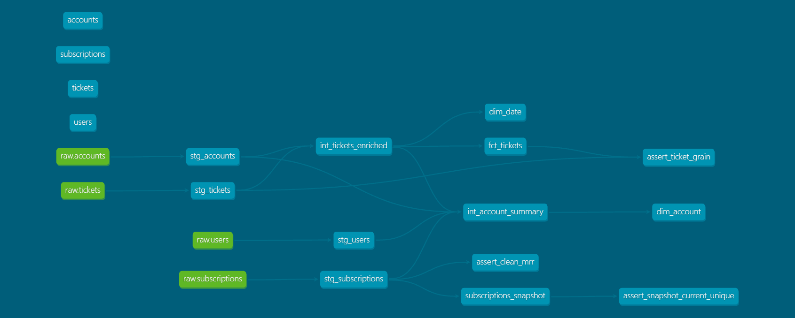

# CloudDesk - Mini Project 2

## Project Overview

This project uses dbt and DuckDB to clean, transform,
and organize CloudDesk data for business reporting.

The dataset contains four sources:
- Accounts
- Subscriptions
- Users
- Support tickets

## Part 1: Data Modeling

The project has three data layers.

### Staging Layer
- stg_accounts
- stg_subscriptions
- stg_users
- stg_tickets

This layer cleans the raw data, fixes inconsistent
values, removes duplicate users, and changes data types.

### Intermediate Layer
- int_account_summary
- int_tickets_enriched

This layer joins data and calculates business metrics.

### Marts Layer
- fct_tickets
- dim_account
- dim_date

This layer provides tables for business reporting
and analysis.

### SCD Type 2 Snapshot

The subscriptions_snapshot tracks changes in
subscription plans, seats, MRR, and status over time.

## Part 2: Data Quality Tests

The project contains 41 data quality tests covering:

- Unique
- Not null
- Accepted values
- Relationships
- Custom SQL tests

Each test includes comments explaining why it matters
and what could go wrong if it fails.

## Data Cleaning Decisions

- Standardize text values.
- Remove duplicate user emails.
- Replace missing account industries with Unknown.
- Keep missing ticket closing times for open tickets.
- Exclude invalid MRR from cleaned revenue.

The maximum valid MRR of 4999 is an assumption
made for this project.

## Tools Used

- Python
- dbt
- DuckDB
- SQL
- VS Code
- Git and GitHub

## How to Run the Project

Install dbt-duckdb:

    pip install dbt-duckdb

Run the following commands:

    dbt seed --profiles-dir .
    dbt run --profiles-dir .
    dbt snapshot --profiles-dir .
    dbt test --profiles-dir .

## Execution Results

| Command | Passed | Errors |
|---|---:|---:|
| dbt run | 9 | 0 |
| dbt test | 41 | 0 |
| dbt snapshot | 1 | 0 |

## Screenshots

- [dbt run](screenshots/01_dbt_run.png)
- [dbt test](screenshots/02_dbt_test.png)
- [dbt snapshot](screenshots/03_dbt_snapshot.png)
- [DAG](screenshots/04_dag.png)

## Data Lineage

## Conclusion

This project transforms raw CloudDesk data into
clean and organized tables for business analysis.

All 9 models, 41 tests, and 1 snapshot ran
successfully with zero errors.